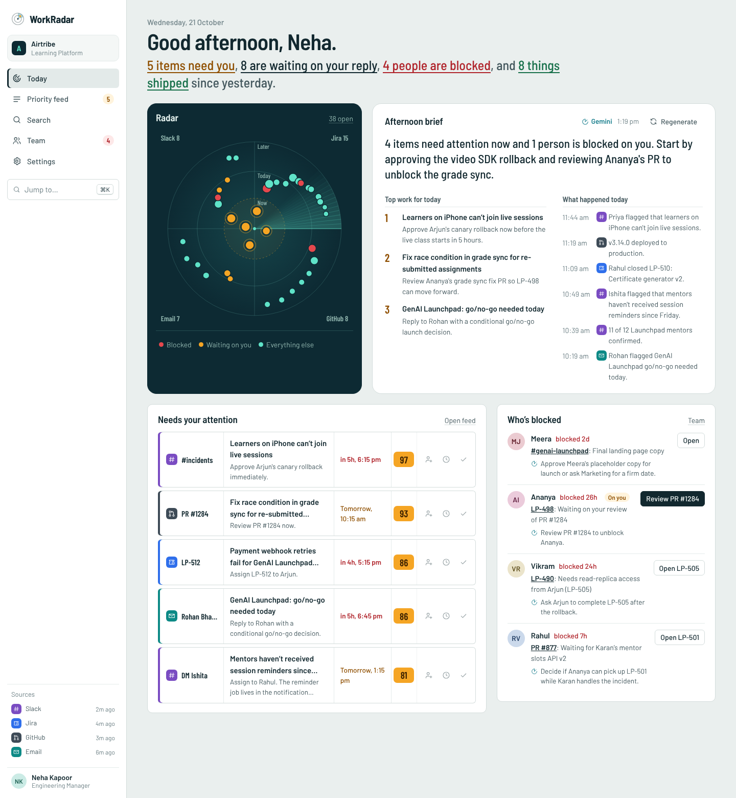
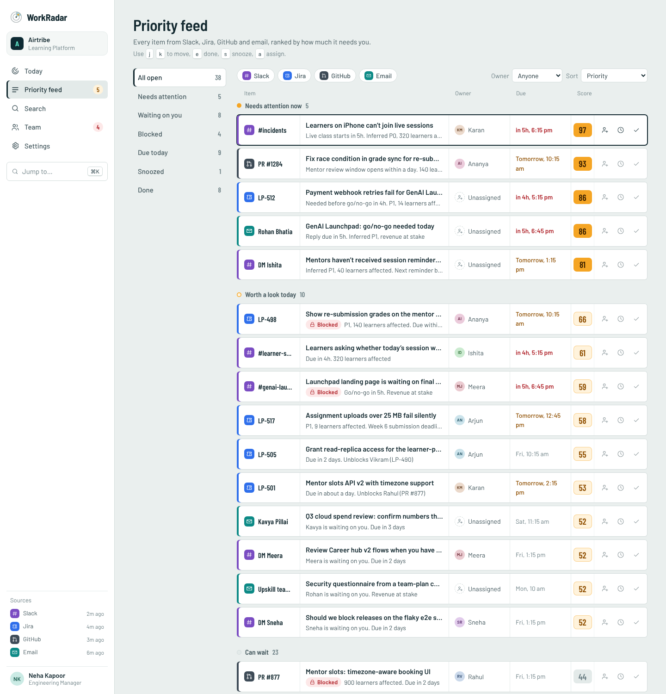
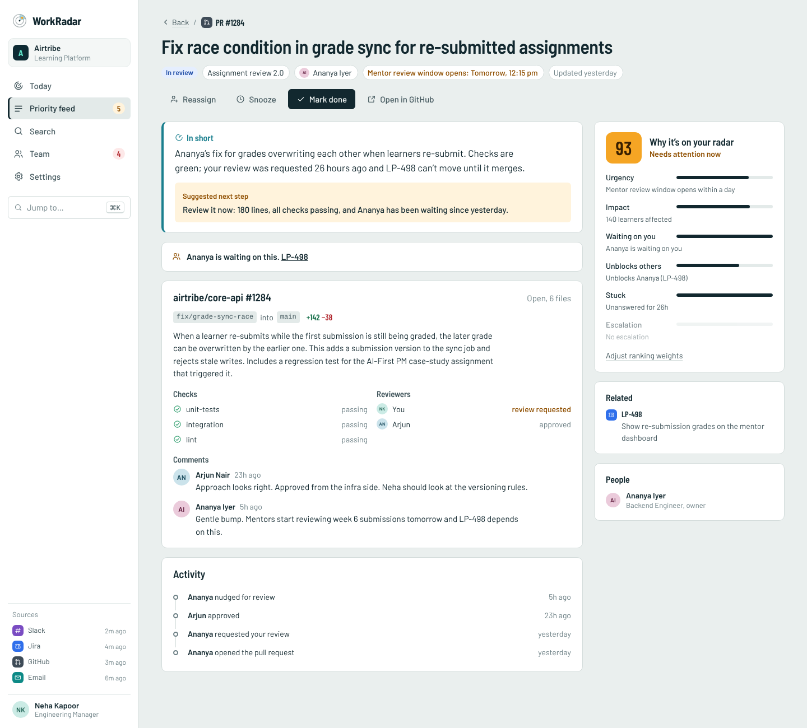
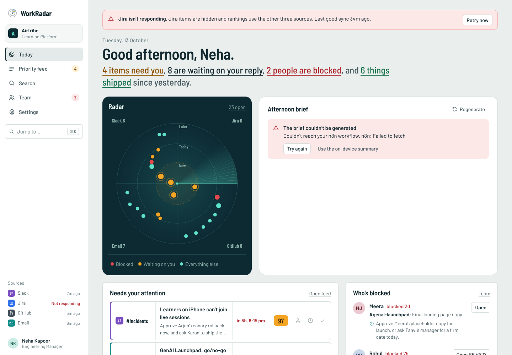
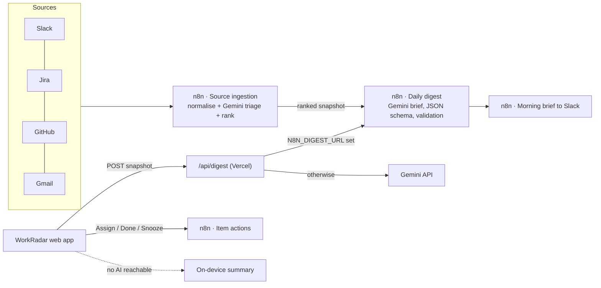

# WorkRadar

**One AI-ranked view of your team’s work across Slack, Jira, GitHub and email.**

WorkRadar helps an engineering manager answer four questions in under a minute each morning, without opening four tools:

1. What is my top work for today?
2. What happened today?
3. What needs my attention right now?
4. Who on my team is blocked?

Built by **Aditya Singh** as the capstone for the Airtribe AI Product Management program. The demo workspace is an Airtribe Learning Platform team, with mock data covering live sessions, AI-assisted assignment review, the GenAI Launchpad launch, Mentor Connect and the Career hub.

> **Mock data.** All people, messages and tickets are fictional and generated relative to the current time, so the demo always reads as “today”. Backend integrations run in n8n demo mode; see [`n8n/`](n8n/).



## What’s inside

| Screen | What it does |
|---|---|
| **Today** (dashboard) | Greeting with live counts, a radar of every open item (distance from the centre is urgency, colour is state), the AI brief, what needs attention, and who’s blocked with a suggested unblock. |
| **Priority feed** | Every item ranked by an explainable 0–100 score and grouped into *Needs attention now*, *Worth a look today* and *Can wait*. Views for waiting on you, blocked, due today, snoozed and done; source and owner filters; keyboard triage (`j`/`k`, `e`, `s`, `a`). |
| **Item detail** | AI summary and suggested next step, dependencies (blocked by / waiting on this), the source-specific detail (Slack thread, Jira fields, PR checks and reviewers, email), activity timeline, and *Why it’s on your radar* with the score broken down by factor. |
| **Search** | Plain-language search that turns words into filters (“blocked prs waiting on me”, “ananya p1”, “launchpad”), with chips you can remove, tabs by source, and a ⌘K command palette everywhere. |
| **Team** | Each person’s load, urgent items, what they shipped today and what they’re blocked on, sorted by who needs you first. |
| **Settings** | AI engine (automatic, n8n only, on-device), n8n webhooks with a connection test, live ranking weights, simulated source outages, and an empty-workspace preview. |
| **Actions** | Assign (with an AI-suggested owner), Mark done and Snooze everywhere, with undo. Actions sync to n8n when it’s connected. |
| **States** | First-run empty workspace, empty views, no search results, source outage banner, AI error with retry and on-device fallback, 404. |

## Design

- **Figma:** [WorkRadar hi-fi screens](https://www.figma.com/design/Q8RHXzIj6yOqBR4HDq5hn5), editable layers in the air-traffic-control direction (dark radar scope, flight-strip rows, Barlow type).
- **All 15 screens as PNG:** [`docs/screens/`](docs/screens): Today (light and dark), Priority feed, Item detail, Assign, Search, Command palette, Team, Mark done + Undo, three empty states, the outage and AI error state, and mobile.
- **Regenerate the Figma file:** [`design/figma-plugin/`](design/figma-plugin) rebuilds every screen from the running app as editable layers.

| Priority feed | Item detail | Error state |
|---|---|---|
|  |  |  |

## How the AI works



- **Ranking is deterministic and explainable.** Six weighted signals (urgency, impact, unblocks others, waiting on you, stuck, escalation) produce the score, and every item shows why. P0 incidents are pinned to the top. Weights are adjustable in Settings.
- **AI writes and triages; it doesn’t rank.** Gemini writes the brief from the ranked snapshot and triages unstructured Slack and email threads (priority, waiting on you, blocked, next step). Output is constrained by a JSON schema and validated: unknown item IDs are dropped.
- **It never comes up empty.** The app tries n8n, then the serverless Gemini route, then an on-device summary, and labels which engine wrote the brief.

## Run it locally

```bash
npm install
npm run dev          # http://localhost:5173
npm run build        # production build in dist/
npm run typecheck
node n8n/validate.mjs
```

Without any keys the app runs fully on its built-in data with the on-device summary.

## Deploy (free) on Vercel with real AI summaries

1. Sign in to [vercel.com](https://vercel.com) with GitHub and **Add New → Project → Import** this repository. Vercel detects Vite automatically.
2. In **Environment Variables** add `GEMINI_API_KEY` (from [Google AI Studio](https://aistudio.google.com/apikey)).
   Optional: `GEMINI_MODEL`, `N8N_DIGEST_URL`, `N8N_ACTION_URL`. See [`.env.example`](.env.example).
3. **Deploy**. The brief on the Today page now says “Gemini” instead of “On-device summary”.

The key stays on the server: the browser only talks to `/api/digest`, which rejects cross-origin calls and oversized payloads, and retries on `gemini-3.5-flash-lite` if the default model is rate-limited.

## n8n

Four n8n workflows run the AI layer: digest API, source ingestion & ranking, item actions, and a morning brief to Slack. They run on n8n Cloud (recommended, nothing to install) or self-hosted with Docker. See **[n8n/README.md](n8n/README.md)**.

## Project structure

```
src/
  data/            Airtribe team and mock items (relative timestamps)
  lib/             scoring, brief, AI client, search parser, store, router
  components/      radar scope, AI brief, strips, menus, layout, palette
  pages/           Today, Priority feed, Item detail, Search, Team, Settings
  styles/          design tokens and components (light and dark)
api/               Vercel edge routes: /api/digest, /api/action, shared prompt
n8n/               workflows, Code-node sources, mock source payloads, validator
docs/              PRD, AI workflow document, screen exports
design/            Figma plugin that rebuilds the hi-fi screens
```

Stack: React 18, TypeScript, Vite, hand-written CSS (no UI framework), Vercel Edge Functions, n8n, Gemini. No runtime dependencies beyond React.

## Documents

- [Product Requirements Document (PDF)](docs/WorkRadar-PRD.pdf)
- [AI Workflow Document (PDF)](docs/WorkRadar-AI-Workflow.pdf)
- [Demo script](docs/DEMO-SCRIPT.md)

The PDFs are generated from `docs/src/*.html` with `python3 docs/src/build.py`.

## Credits

Typeface: [Barlow](https://github.com/jpt/barlow) by Jeremy Tribby, SIL Open Font License, self-hosted. Icons and illustrations drawn for this project. Airtribe is referenced only as the context for this concept project; it is not affiliated with or endorsed by Airtribe.
